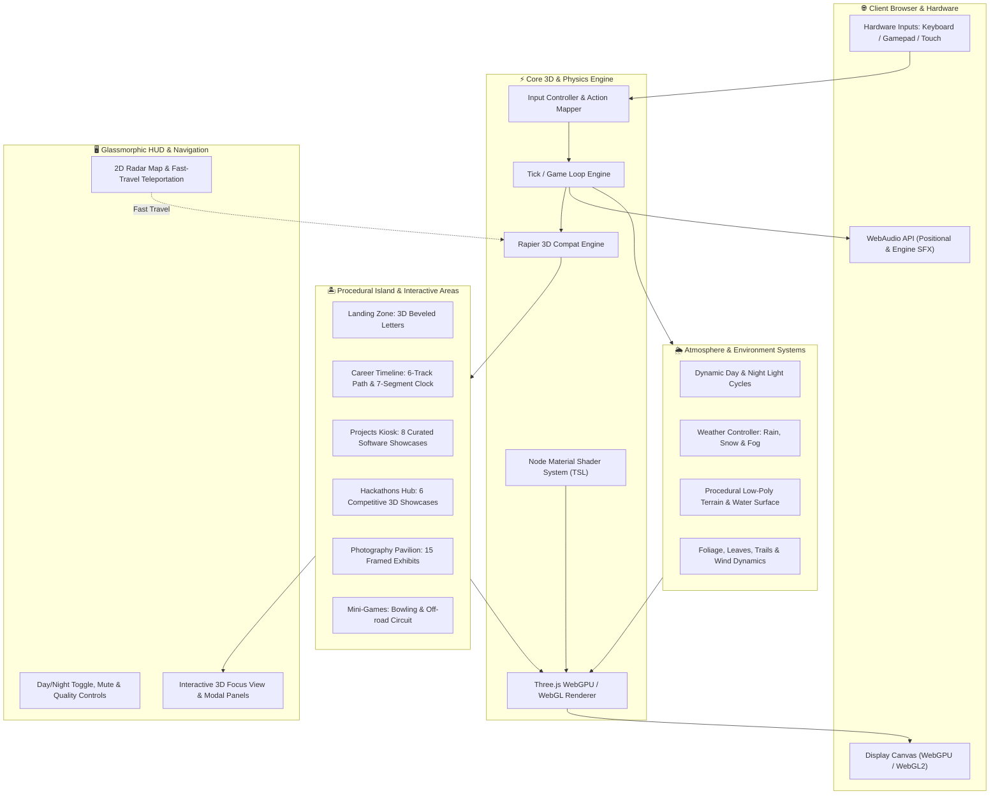
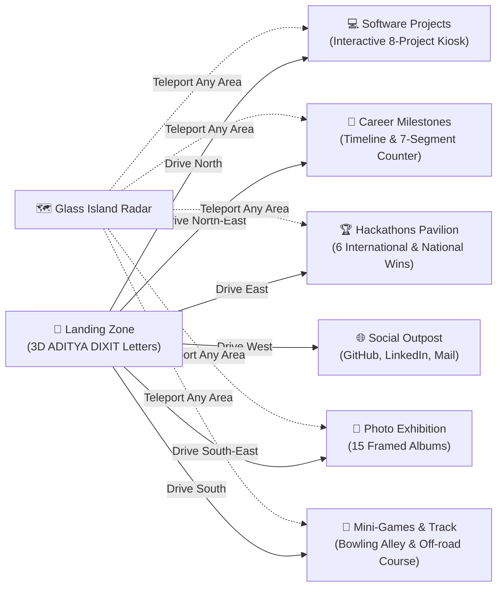
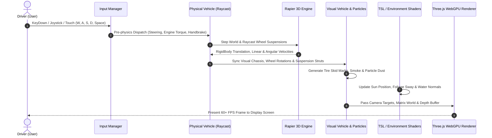
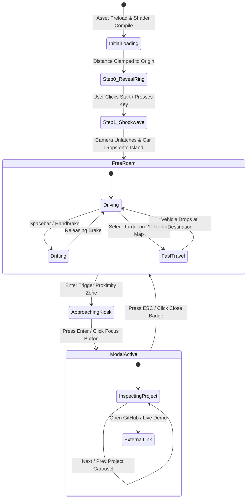

<div align="center">

# 🏎️ ADITYA DIXIT — 3D INTERACTIVE WEBGPU PORTFOLIO

### *An Immersive 3D Open-World Island & Physics Simulation showcasing Engineering, Hackathons, and Creative Systems.*

[](https://threejs.org/)
[](https://rapier.rs/)
[](https://vitejs.dev/)
[](https://greensock.com/)
[](LICENSE)
[](https://github.com/Aditya-dxt/Portfolio-v2)

<br/>

[✨ Live Demo](https://adityadixit.vercel.app/) • [🚀 Features](#-key-features) • [📐 Architecture & Views](#-system-architecture--diagram-views) • [🎮 Controls](#-controls-guide) • [🛠️ Tech Stack](#-technology-stack) • [📦 Setup & Run](#-local-installation--setup) • [🌐 Deployment](#-production-deployment)

<br/>

<!-- Add your new hero banner image here:  -->

</div>

---

## 🌟 Overview

**Portfolio-v2** is an interactive, gamified 3D portfolio experience built with **Three.js**, **WebGPU Node Shaders (TSL)**, and **Rapier 3D Physics**. Rather than browsing a standard static webpage, visitors pilot a responsive physics-simulated sports buggy across a handcrafted low-poly archipelago. 

As you navigate through dynamic terrain, real-time day/night cycles, and atmospheric weather simulations, you discover interactive 3D pavilions and kiosks spotlighting software engineering projects, hackathon achievements, career milestones, photography exhibitions, and interactive mini-games.

---

## 📐 System Architecture & Diagram Views

Below are visual architecture and engineering views diagrammed with **Mermaid** representing the core subsystems, runtime game loop, world spatial layout, and state machine transitions.

### 1. High-Level Engine Architecture View


---

### 2. World Layout & Spatial Navigation View


---

### 3. Step-by-Step Physics & Render Loop View


---

### 4. Interactive Kiosk & State Machine View


---

## 🚀 Key Features

| Category | Highlights & Capabilities |
| :--- | :--- |
| **🏎️ Physics Vehicle Simulation** | Built on **Rapier 3D**, featuring 4-wheel raycast suspension, drift slip physics, dynamic friction coefficients, impact sounds, and ground-skid decal trails. |
| **🏆 3D Hackathon Pavilion** | Custom 3D wooden kiosk showcasing **6 top hackathons** with high-resolution framed 16:9 graphics, organizer distinctions, team roles, and repository/demo links. |
| **💻 Software Projects Zone** | 3D billboard kiosk highlighting **curated software projects** (CivicSentinel AI, SneakerVault, CampusIQ, Brew & Co., AegisCore AI, MangoAgent IoT, Precedent, GramSetu, Interview AI). |
| **📸 Photography Gallery** | 3D framed gallery displaying **15 themed photography albums** with contextual focal cameras and smooth depth-of-field zoom transitions. |
| **💼 Career Timeline** | 6 career milestones spanning engineering internships, leadership, and startup work, featuring an animated **rolling 7-segment clock display**. |
| **☀️ Day/Night & Weather Shaders** | Custom **TSL (Three.js Shading Language)** shaders with smooth sun/moon transit, procedural rain droplets, lightning flashes, falling snow, and wind-blown foliage. |
| **🗺️ 2D Island Radar & Fast Travel** | Glassmorphism radar map rendered with top-down island topography, dynamic player heading indicator, and click-to-teleport capabilities. |
| **🎵 Interactive WebAudio Engine** | Synthesized vehicle engine revs, gear shifts, tire squeals, environmental wind ambient, and physical impact audio nodes. |

---

## 🏆 Featured Hackathons in 3D Pavilion

1. **India Innovates 2026** — *National Smart Automation Series* | **1st Prize Winner** (`National Winner`)
2. **FAR AWAY 2026** — *Zuup Labs International Series* | **Semi-Finalist** (`New Delhi to Tokyo Prototype`)
3. **iQOO Hackathon 2026** — *Hardware Acceleration & Mobile Gaming Challenge* | **Finalist & Merit Award**
4. **Green Bharat Hackathon 2026** — *Ministry of Electronics & IT (MeitY)* | **Top 5 Nationwide**
5. **AVEVA Hackathon 2025** — *AVEVA Industrial AI & Digital Twin Challenge* | **Finalist — Industrial Innovation**
6. **Technex '25 Hackathon** — *IIT Varanasi (BHU) Annual Technical Championship* | **Winner — Most Innovative Solution**

---

## 🎮 Controls Guide

| Action | Keyboard | Gamepad | Mobile Touch |
| :--- | :--- | :--- | :--- |
| **Accelerate** | `W` or `↑` | Right Trigger (`R2` / `RT`) | On-screen Accelerate Button |
| **Reverse / Brake** | `S` or `↓` | Left Trigger (`L2` / `LT`) | On-screen Brake Button |
| **Steer Left / Right** | `A` / `D` or `←` / `→` | Left Analog Stick | On-screen Steering Wheel |
| **Handbrake / Drift** | `Space` | `A` or `X` Button | Drift Icon |
| **Reset Vehicle Position** | `R` | `Y` Button / Select | Reset Badge |
| **Toggle Day / Night** | `N` or Header Button | D-Pad Up | Sun/Moon Header Toggle |
| **Toggle Island Radar** | `M` or Radar Button | D-Pad Down | Minimap Radar Icon |
| **Inspect / Enter Kiosk** | `Enter` | `A` Button | Enter Button |
| **Exit Kiosk / Close Modal**| `Escape` | `B` Button | Close [X] Button |

---

## 🛠️ Technology Stack

```
Portfolio-v2 Core Stack
├── Graphics Engine    : Three.js (r160+), TSL (Three.js Shading Language)
├── Physics Engine     : @dimforge/rapier3d-compat (WebAssembly 3D Physics)
├── Build & Dev Server : Vite 5, Node.js 18+
├── Animation Library  : GSAP (GreenSock Animation Platform)
├── Asset Pipeline     : glTF-Transform, KTX2, Basis Universal Texture Compressor
├── Styles & UI        : Stylus, Glassmorphism CSS, Responsive SVG Vectors
├── Sound Design       : Native WebAudio API Synthesizer & Spatial Nodes
└── Deployment Target  : Vercel / Netlify / Cloudflare Pages
```

---

## 📦 Local Installation & Setup

### Prerequisites
- [Node.js](https://nodejs.org/) (version `18.x` or higher recommended)
- `npm` or `pnpm`

### Step 1: Clone the Repository
```bash
git clone https://github.com/Aditya-dxt/Portfolio-v2.git
cd Portfolio-v2
```

### Step 2: Install Dependencies
```bash
npm install --force
```

### Step 3: Run Local Development Server
```bash
npm run dev
```
Open your browser and navigate to `http://localhost:5173`.

### Step 4: Build for Production
```bash
npm run build
```
Production assets are generated in the `dist/` directory, optimized with asset hashing and chunking.

---

## 🌐 Production Deployment

### Option A: Deploy to Vercel (Recommended)
This repository includes a production-ready `vercel.json` configuration file:
1. Push your code to your GitHub repository.
2. Visit [Vercel](https://vercel.com/) and click **"Add New Project"**.
3. Import `Aditya-dxt/Portfolio-v2`.
4. Leave framework settings as **Vite** (Build: `npm run build`, Output: `dist`).
5. Click **Deploy**.

### Option B: Deploy to Netlify
A configured `netlify.toml` file is provided:
1. Connect your repository on [Netlify](https://www.netlify.com/).
2. Netlify will auto-detect:
   - **Build Command**: `npm run build`
   - **Publish Directory**: `dist`
3. Click **Deploy Site**.

---

## 🗜️ 3D Asset Compression Pipeline

To ensure sub-2-second load times on mobile and low-bandwidth connections, 3D assets and textures are compressed with ETC1S / KTX2:

```bash
# Compress all GLB models and textures in the static directory
npm run compress
```

This pipeline:
- Scans `static/` for uncompressed `.glb` meshes and compresses embedded textures with `etc1s`.
- Traverses image textures and re-encodes to GPU-ready KTX2/Basis formats.
- Converts UI raster graphics to modern lightweight WebP formats.

---

## 👤 Author & Contact

**Aditya Dixit**
- 🌐 **Portfolio**: [adityadixit.vercel.app](https://adityadixit.vercel.app/)
- 💻 **GitHub**: [@Aditya-dxt](https://github.com/Aditya-dxt)
- 💼 **LinkedIn**: [Aditya Dixit](https://linkedin.com/in/aditya-dxt)
- 📧 **Email**: [adityadxt1910@gmail.com](mailto:adityadxt1910@gmail.com)

---

## 📄 License

This project is licensed under the [MIT License](LICENSE) — feel free to explore, learn, and build upon it!
